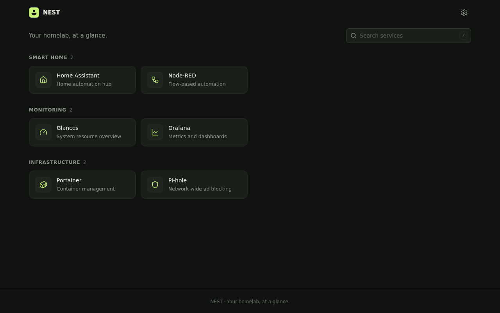
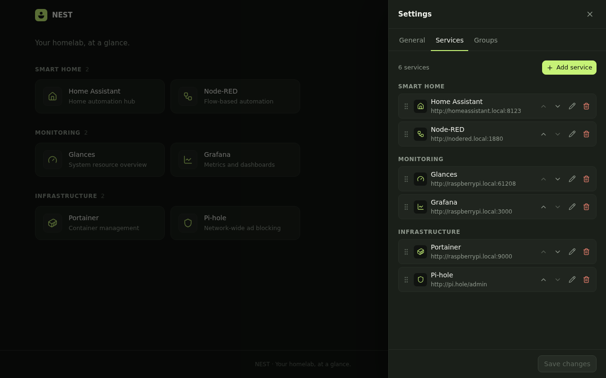
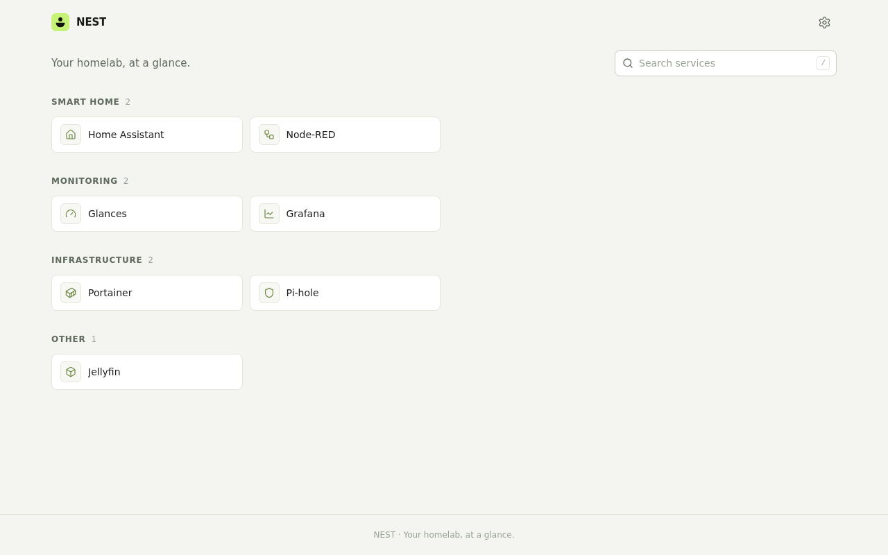

<p align="center">
  
</p>

<h1 align="center">NEST</h1>
<p align="center"><em>Your homelab, at a glance.</em></p>

NEST is a minimal, self-hosted dashboard for a Raspberry Pi. It is a clean, customizable
landing page with links to the applications running in your homelab: Home Assistant,
Glances, Portainer, Pi-hole, Grafana, and anything else with a URL.

It is deliberately **not** a monitoring platform. No charts, no polling, no widgets, no
accounts. A beautiful, lightweight home for your services. Nothing more, nothing less.



## Features

- **Service cards** with icon, name and a short description, organised into groups.
- **Full customization from the UI**: title, subtitle, dark/light/system theme, accent
  color, columns, card size, search, footer, background color or image.
- **Service management**: add, edit, delete, enable/disable, group, reorder (drag and
  drop or arrow buttons), open in same or new tab, built-in Lucide icons or a custom
  image URL with automatic fallback.
- **Groups**: create, rename, reorder and delete. Ungrouped services land in "Other".
- **Instant client-side search** by name, description and group (`/` focuses it,
  `Esc` clears it).
- **Live preview** while editing, with unsaved-change protection.
- **Central persistence** in a single human-readable `config.json` with validation,
  atomic writes and an automatic `.bak` of the previous version. The same configuration
  is shown on every device.
- **Responsive** for desktop, tablet and phone; keyboard accessible; respects
  `prefers-reduced-motion`.
- **Lightweight**: one Node process, no database, no external fonts, no third-party
  requests, no background jobs. Works fully offline on your LAN.

<p>
  
  
</p>

## Prerequisites

- A Raspberry Pi (3, 4, 5 or similar) running a 64-bit or 32-bit (armv7) Linux with
  Docker and the Docker Compose plugin, or Podman with `podman-compose`, installed.
  Any other Linux/amd64 host works too. Pi Zero / Pi 1 (armv6) are not supported by
  the official Node.js images.
- About 150 MB of disk space for the image and a few KB for the configuration.

Running without Docker is also possible with Node.js 22 or newer (see
[Running without Docker](#running-without-docker)).

## Installation with Docker Compose

```bash
git clone https://github.com/flaaaps/nest.git
cd nest
docker compose up -d --build
```

With Podman, use `podman-compose up -d --build` instead; everything else is identical.

The first build compiles the UI on the Pi and takes a few minutes. When it finishes, open

```
http://raspberrypi.local
```

from any device on your network. Replace `raspberrypi.local` with your Pi's hostname or
IP address (`hostname -I` on the Pi shows it). If `.local` names do not resolve on your
device, use the IP address.

NEST is published on port 80 of the host by default, so no port is needed in the URL.

On first start NEST writes a default configuration with a few example services
(Home Assistant, Node-RED, Glances, Grafana, Portainer, Pi-hole). **These are examples
only.** The hostnames, ports and paths must be adapted to your environment. Edit or
delete them through the settings panel (gear icon, top right).

### Choosing the port

To use another host port, create a `.env` file next to `docker-compose.yml` (see
`.env.example`):

```
NEST_PORT=3001
```

then run `docker compose up -d` (or `podman-compose up -d`). The container always
listens on 8080 internally; only the host-side port changes.

**Ports below 1024 with rootless Podman or Docker.** Linux reserves ports below 1024
for root. Rootless containers therefore fail to publish port 80 with
`bind: permission denied` or `rootlessport ... bind` errors. Allow it once on the Pi:

```bash
sudo sysctl -w net.ipv4.ip_unprivileged_port_start=80
echo 'net.ipv4.ip_unprivileged_port_start=80' | sudo tee /etc/sysctl.d/90-nest-port80.conf
```

The second line keeps the setting across reboots. Alternatively run the stack as root
(`sudo docker compose up -d`), or pick a port of 1024 or above.

## Configuration and environment variables

| Variable             | Default (Docker)       | Description                                                                 |
| -------------------- | ---------------------- | --------------------------------------------------------------------------- |
| `NEST_PORT`          | `80` (host, Compose) / `8080` (server) | In Compose: the host port NEST is published on. For the server itself: the port it listens on. |
| `NEST_HOST`          | `0.0.0.0` (`127.0.0.1` outside Docker) | Interface to bind to.                                      |
| `NEST_CONFIG_DIR`    | `/data`                | Directory holding `config.json` (mounted as a volume).                       |
| `NEST_STATIC_DIR`    | `/app/web/dist`        | Directory with the built web UI.                                            |
| `NEST_AUTH_USER`     | unset                  | Enable HTTP Basic authentication (must be set together with the password).  |
| `NEST_AUTH_PASSWORD` | unset                  | Password for Basic authentication.                                          |
| `NEST_VERSION`       | package version        | Version string reported by `/api/health`.                                    |
| `TZ`                 | `UTC`                  | Timezone for log timestamps (Compose only).                                 |

## Using the dashboard

Everything is configured in the browser; you never need to edit source code.

- **Open settings** with the gear icon in the header (or the button in the empty state).
- **General** tab: title, subtitle, search and footer visibility, theme, accent and
  background colors, background image URL, columns, card size, empty-group visibility,
  and *Reset to defaults*.
- **Services** tab: *Add service*, then the pencil to edit, the trash icon to delete,
  arrows or drag-and-drop to reorder. Dropping a card onto a service in another group
  moves it into that group. Disabled services stay in the list with a "Disabled" badge
  but are hidden from the dashboard.
- **Groups** tab: add a group with the text field, rename inline, reorder with the
  arrows, delete with the trash icon (its services move to "Other").
- Changes are previewed live on the dashboard behind the panel and are written to disk
  only when you press **Save changes**. Closing the panel with unsaved changes asks for
  confirmation.

## Where the configuration is stored

Inside the container the configuration lives at `/data/config.json`, backed by the
`nest-data` Docker volume. Every save first copies the previous version to
`config.json.bak`, then writes the new file atomically.

To find the volume on the host:

```bash
docker volume inspect nest_nest-data --format '{{ .Mountpoint }}'
```

If you prefer a plain folder, switch the volume in `docker-compose.yml` to
`./data:/data` and create it once with `mkdir -p data && sudo chown 1000:1000 data`
(the container runs as the unprivileged `node` user, uid 1000).

### Example `config.json`

```json
{
  "version": 1,
  "dashboard": {
    "title": "NEST",
    "subtitle": "Your homelab, at a glance.",
    "theme": "dark",
    "accentColor": "#C6F277",
    "columns": "auto",
    "cardSize": "comfortable",
    "showSearch": true,
    "showFooter": true,
    "footerText": "NEST · Your homelab, at a glance.",
    "backgroundColor": "",
    "backgroundImageUrl": "",
    "showEmptyGroups": false
  },
  "groups": [
    { "id": "smart-home", "name": "Smart Home" }
  ],
  "services": [
    {
      "id": "home-assistant",
      "name": "Home Assistant",
      "url": "http://homeassistant.local:8123",
      "description": "Home automation hub",
      "icon": "House",
      "iconUrl": "",
      "groupId": "smart-home",
      "enabled": true,
      "openInNewTab": false
    }
  ]
}
```

Rules enforced on save (by the UI and the server):

- `theme` is `dark`, `light` or `system`; `columns` is `"auto"` or 2 to 6; `cardSize` is
  `compact` or `comfortable`.
- Colors are six-digit hex (`#RRGGBB`). `backgroundColor` may be empty.
- `url`, `iconUrl` and `backgroundImageUrl` must be absolute `http://` or `https://`
  URLs (`iconUrl` and `backgroundImageUrl` may be empty).
- `icon` must be one of the built-in names (see `shared/src/index.ts`, `ICON_NAMES`).
- `groupId` must be `null` or the id of an existing group; ids must be unique.
- Unknown keys are rejected so typos do not silently disappear.

You can edit the file by hand while NEST is stopped. If the file is unreadable on start,
NEST does **not** overwrite it: the dashboard shows the error and offers to replace it
with the defaults, in which case the broken file is kept as
`config.json.invalid-<timestamp>`.

## Backup and restore

Backup:

```bash
docker compose cp nest:/data/config.json ./nest-config-backup.json
```

Restore:

```bash
docker compose cp ./nest-config-backup.json nest:/data/config.json
docker compose restart nest
```

The configuration can also be fetched from and pushed to the API from the same machine
(or any client on the LAN, see [Security](#security)):

```bash
curl http://raspberrypi.local/api/config > backup.json
curl -X PUT -H 'Content-Type: application/json' --data-binary @backup.json \
  http://raspberrypi.local/api/config
```

## Updating

```bash
cd nest
git pull
docker compose up -d --build
```

Your configuration lives in the volume and is untouched by updates. Should a future
version change the configuration format, it will be documented here with a migration
note.

## API

| Method | Path                   | Description                                                 |
| ------ | ---------------------- | ----------------------------------------------------------- |
| GET    | `/api/config`          | Current configuration (500 with details if the file is invalid). |
| PUT    | `/api/config`          | Validate and replace the whole configuration. Returns the saved document, 400 on validation errors. |
| GET    | `/api/config/defaults` | The configuration NEST ships with.                          |
| GET    | `/api/health`          | `{"status":"ok","version":"…","config":"ok"|"invalid","uptime":…}`. Checks only NEST itself, never your services. |

Request bodies are limited to 256 KiB and must be `application/json`.

## Security

NEST is designed for a trusted home network and ships without authentication. Even so:

- Every configuration write is validated against a strict schema; URLs are restricted to
  `http`/`https`; the API never touches any file other than `config.json` in the
  configured directory.
- State-changing requests from other origins are rejected (`Origin` /
  `Sec-Fetch-Site` checks, no CORS), so a malicious website you visit cannot rewrite
  your dashboard.
- Responses carry a strict Content Security Policy and other hardening headers; the UI
  never renders user-provided HTML.
- The container runs as a non-root user with `no-new-privileges`.

**Do not expose NEST directly to the internet.** If you need access from outside your
LAN, use a VPN (WireGuard, Tailscale) or put NEST behind an authenticating reverse proxy
(Caddy, Nginx, Authelia, …). For a simple password prompt on the LAN, enable Basic auth
in `docker-compose.yml`:

```yaml
environment:
  NEST_AUTH_USER: admin
  NEST_AUTH_PASSWORD: a-long-random-password
```

Basic auth sends credentials in clear text over plain HTTP, so combine it with HTTPS from
a reverse proxy if the network is not fully trusted.

Note that custom icon URLs and the background image URL are loaded by *your browser*,
so they can point at an internet host, but NEST itself never makes outbound requests.

## Running without Docker

Requires Node.js 22+ and pnpm (via `corepack enable`).

```bash
pnpm install
pnpm build                       # builds web/dist and server/dist
NEST_PORT=8080 NEST_HOST=0.0.0.0 NEST_CONFIG_DIR=/var/lib/nest pnpm start
```

Binding port 80 directly requires root or the sysctl described in
[Choosing the port](#choosing-the-port).

For development, `pnpm dev` starts the API on `127.0.0.1:8080` (configuration in
`./data`) and the Vite dev server with hot reload on `http://127.0.0.1:5173`.

## Troubleshooting

| Symptom | What to check |
| --- | --- |
| Page does not load | `docker compose ps` shows the container running and healthy; `docker compose logs nest` for errors. |
| `bind: address already in use` on start | Another service already uses the host port. Find it with `ss -ltnp \| grep ':80 '` and either stop it or set a different `NEST_PORT` in `.env`. |
| `bind: permission denied` / `rootlessport` error on start | Rootless containers cannot use ports below 1024 by default. See [Choosing the port](#choosing-the-port). |
| "NEST is not reachable" in the browser | The server process died or a reverse proxy is misconfigured. Check the logs. |
| "Configuration could not be read" | `config.json` is malformed. Fix it by hand (the error names the problem) or click *Replace with defaults*; the broken file is kept. |
| Changes are not saved | A 403 means the request was treated as cross-site (e.g. the dashboard is embedded or proxied under a different host). A 400 shows the validation error in the panel. |
| Custom icon does not show | The URL must be reachable *from the browser* and served with an image content type. NEST falls back to the built-in icon. |
| A service card opens nothing | NEST only links to the URL; the target service itself must be running and reachable from your device. |
| Hostname `raspberrypi.local` does not resolve | Use the Pi's IP address or configure your DNS/Pi-hole with a local record. |
| Permission denied writing `/data` | With a bind mount, `chown 1000:1000` the folder (container uid); with rootless Podman use `podman unshare chown 1000:1000 data`. |

## Project layout

```
shared/   types, defaults and validation helpers shared by server and UI
server/   Fastify API + static file serving + JSON config store (bundled with esbuild)
web/      React + Vite frontend, plain CSS with custom properties
docs/     screenshots
Dockerfile, docker-compose.yml
```

Development commands (run from the repo root): `pnpm typecheck`, `pnpm test`,
`pnpm build`.

## License

MIT
